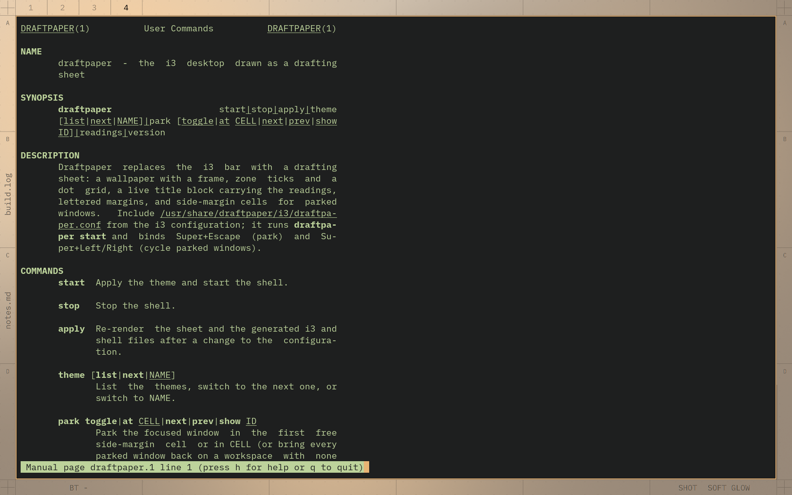
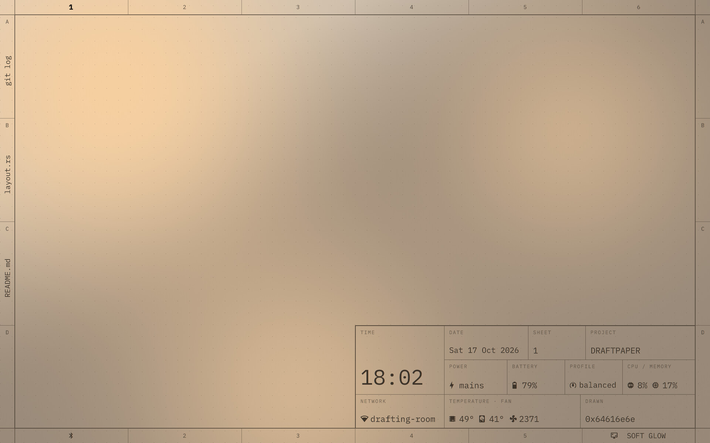
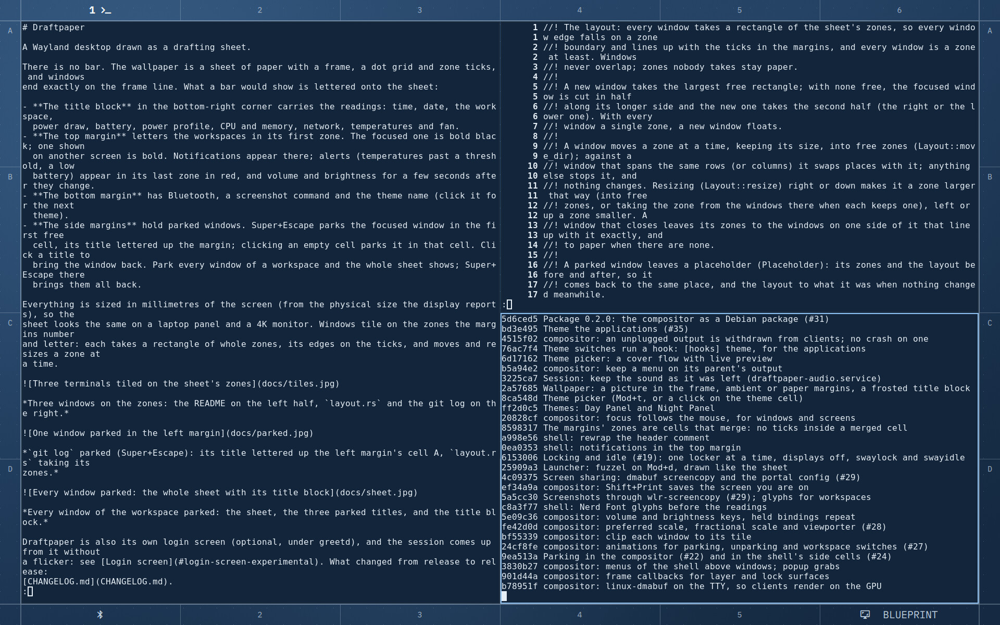
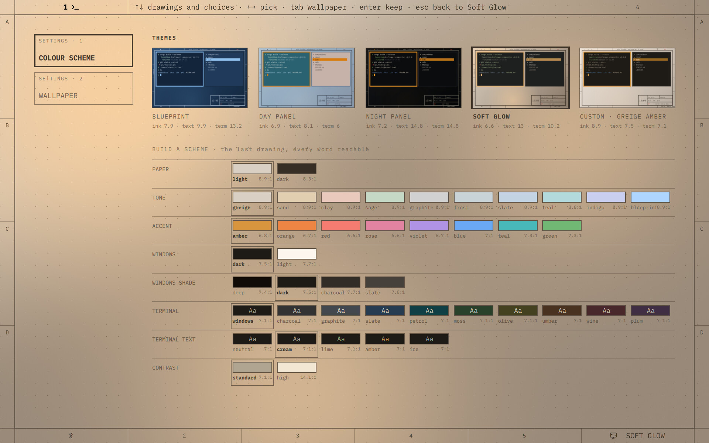

# Draftpaper

A Wayland desktop drawn as a drafting sheet.

There is no bar. The wallpaper is a sheet of paper with a frame, a dot grid and zone ticks, and windows
end exactly on the frame line. What a bar would show is lettered onto the sheet:

- **The title block** in the bottom-right corner carries the readings: time, date, the workspace,
  power draw, battery, power profile, CPU and memory, network, temperatures and fan.
- **The top margin** letters the workspaces in its first zone. The focused one is bold black; one shown
  on another screen is bold. Notifications appear there; alerts (temperatures past a threshold, a low
  battery) appear in its last zone in red, and volume and brightness for a few seconds after they change.
- **The bottom margin** has Bluetooth, a screenshot command and the theme name (click it for the next
  theme).
- **The side margins** hold parked windows. Super+Escape parks the focused window in the first free
  cell, its title lettered up the margin; clicking an empty cell parks it in that cell. Click a title to
  bring the window back. Park every window of a workspace and the whole sheet shows; Super+Escape there
  brings them all back.

Everything is sized in millimetres of the screen (from the physical size the display reports), so the
sheet looks the same on a laptop panel and a 4K monitor.



*One window open (the sheet's own shader); `notes.md` and `build.log` parked in the left margin's cells B
and C.*



*Every window of the workspace parked: the sheet, the three parked titles, and the title block.*

## Install

Draftpaper is a Debian package (Debian 13, amd64). It needs Quickshell 0.3 or later, which Debian 13
provides in trixie-backports:

    sudo apt install -t trixie-backports quickshell ./draftpaper_0.2.0_amd64.deb   # from the latest release

Install both from backports in one go: Quickshell brings newer PipeWire libraries from there, and the
recommended wireplumber has to come from the same place.

Log out and pick **Draftpaper** from the display manager's session menu (in GDM, the gear under the
password field). From a text console, run `draftpaper-session`.

The recommended packages are the defaults the keys run: alacritty (or foot), fuzzel, swaylock, swayidle,
grim, slurp and swappy, wireplumber and brightnessctl. Screen sharing in browsers and calls goes through
xdg-desktop-portal-wlr. The sheet is lettered in IBM Plex Mono when it is installed, DejaVu Sans Mono
otherwise; Plex is in Debian's `contrib` section.

The 0.1 releases were an i3 edition (a sheet behind i3 on X11). It is frozen: 0.1.1 stays installable
from the releases, and 0.2 replaces it.

## Keys

Mod is Super (the Windows key). Every key, click and command on one page: [docs/cheatsheet.md](docs/cheatsheet.md).

| Key | |
|---|---|
| Mod+Return | Terminal (alacritty) |
| Mod+d | Launcher (fuzzel) |
| Mod+h/j/k/l, Mod+Up/Down | Move the focus |
| Mod+Shift+h/j/k/l, Mod+Shift+arrows | Move the window |
| Mod+Ctrl+h/j/k/l, Mod+Ctrl+arrows | Resize by a zone (hold to repeat) |
| Mod+1 … Mod+0 | Workspace 1 to 10 |
| Mod+Shift+1 … Mod+Shift+0 | Send the window to a workspace |
| Mod+f | Fullscreen |
| Mod+Shift+q | Close the window |
| Mod+Escape | Park the focused window in the side margin; with every window parked, bring them all back |
| Mod+Left / Mod+Right | Bring back the parked window in the first / last cell, parking the focused one; with nothing parked, move the focus |
| Mod+t | Settings: the colour scheme (presets, or one built from checked choices) |
| Mod+Shift+x | Lock the screen (swaylock) |
| Mod+Shift+p | Lock before every suspend, until turned off or the next login |
| Print | A region to swappy (slurp, grim) |
| Shift+Print | The screen you are on to ~/Pictures |
| Mod+Print | Every screen to ~/Pictures |
| Mod+z | A region magnified, pixel by pixel (slurp, grim, feh) |
| Volume, brightness keys | wpctl, brightnessctl |
| Mod+Shift+e | Leave the session |
| Ctrl+Alt+F1 … F12 | Switch virtual terminal |

Clicks: a workspace number switches to it; an empty side cell parks the focused window there and a
parked window's title brings it back; the profile cell cycles the power profile; volume mutes on click
and changes on scroll; the theme name switches theme.

## Configuration

`~/.config/draftpaper/config.toml`, every key optional. It is read again when it changes.

```toml
theme = "softglow"
margin = 6                 # millimetres between the screen edge and the frame (3 to 20)
glyphs = true              # Nerd Font glyphs before the readings, when a Nerd Font is installed
wallpaper = "~/Pictures/sea.jpg"   # a picture in the frame (draftpaper wallpaper FILE | none)
margins = "paper"          # with a wallpaper: "paper", or "ambient" (the picture's colours)
title_tint = 0.7           # with a wallpaper: how much paper tints the picture under the title block
wallpaper_fit = "fill"     # "fill" (cropped to the frame), "fit" (whole, on the paper), "centre" (own size)
wallpaper_position = "centre"  # where it sits when cropped or smaller: centre, top, bottom, left, right
wallpaper_brightness = 1.0 # less darkens it
wallpaper_wash = 0.0       # how much paper is laid over it (0 to 1)
wallpaper_blur = 0.0       # millimetres
wallpaper_dirs = ["~/Pictures/Wallpapers", "/usr/share/backgrounds"]   # where the settings look

[title]
project = "WORKSTATION"    # default: the host name
drawn = "me"               # default: the user name (shown when there is no custom cell)

[[cell]]                   # cells of your own: the first in the title block's last row, the others
                           # in the bottom margin's free zones, one per zone
label = "TICKET"
command = ["my-timer"]     # its first line of output is the value
interval = 5               # seconds
left = ["my-timer", "toggle"]
right = ["my-timer", "pick"]

[alerts]                   # when temperatures and the battery turn red
cpu = 85                   # degrees Celsius
nvme = 60
fan = 5000                 # RPM
battery = 15               # percent

[idle]
screens_off = 15           # minutes until the screens turn off (0: never)
lock_after = 0             # minutes until the screen locks (0: never)
lock_on_sleep = false      # lock before every suspend

[apps]                     # the applications in the theme's colours
theme = true               # false: leave them alone
skip = []                  # or some of: alacritty foot tmux neovim emacs gtk qt firefox x11

[input]
keyboard_layout = "us"     # xkb layout(s), variant, options
keyboard_options = "ctrl:nocaps"
repeat_delay = 200         # ms
repeat_rate = 25           # per second
tap = true                 # touchpad: tap to click
natural_scroll = true
focus_follows_mouse = true  # the window the pointer enters takes the focus

[layout]
new_window = "column"      # a third window and on: a new column beside the focused one, or "row":
                           # a new row under the focused window (the first two are side by side)

[[rule]]                   # window rules, in order, later ones winning; match on any of:
app_id = "^pavucontrol$"   #   a pattern for the app id (X11: the class)
title = "Volume"           #   a pattern for the title
                           #   pip = true: a browser's picture-in-picture window
float = true               # then: float (at its own size, above the tiles)
sticky = false             #   follow you to every workspace of its screen
place = "centre"           #   or "corner": the frame's bottom-right, above the title block
focus = true               #   false: open without taking the keyboard

[animations]
enabled = true             # false: every change at once
duration_ms = 220

[outputs.eDP-1]               # when the display is plugged in (see Displays)
scale = 1.5                # fractional scales work
position = [0, 0]          # logical pixels

[bindings]                 # key = action; "none" removes a default
"Mod+Return" = "spawn foot"
```

## Displays

A display gets its preferred mode when it is plugged in, right of the others, unless
`[outputs.<name>]` in config.toml gives its scale and position (`wlr-randr` lists the names).

Tools that speak wlr-output-management arrange the displays while the session runs: `wlr-randr` from
a shell, wdisplays with a mouse, and kanshi, which switches between profiles as displays come and go
(docked, undocked). kanshi matches displays by name or by make, model and serial as `wlr-randr` shows
them:

```
# ~/.config/kanshi/config
profile undocked {
  output eDP-1 enable scale 1.5
}
profile docked {
  output eDP-1 disable
  output "DEL DELL U2720Q ABC123" mode 3840x2160 position 0,0 scale 1.5
}
```

Debian's kanshi has no service of its own; to start it with the session:

```
# ~/.config/systemd/user/kanshi.service
[Unit]
PartOf=graphical-session.target
After=graphical-session.target

[Service]
ExecStart=/usr/bin/kanshi
Restart=on-failure

[Install]
WantedBy=draftpaper-session.target
```

then `systemctl --user enable kanshi`. A display turned off stays off until it is turned on again or
unplugged; when every display left is off, they come on again.

Actions: `focus|move|resize left|right|up|down`, `workspace N`, `send N`, `fullscreen`, `close`, `park`,
`park_next`, `park_prev`, `screenshot`, `power off|on`, `reload`, `quit`, `spawn COMMAND`.

## Another account

For work kept under a separate unix account, `draftpaper-as USER [COMMAND...]` runs a program as that
user on the session, or their login shell with no command:

```sh
draftpaper-as client chromium --ozone-platform=wayland --class=client-browser
alacritty --class client-term -e draftpaper-as client
```

It needs sudo to that user and `setfacl` (package `acl`). The user is let onto the display through an
access entry on the Wayland socket, which lasts until the session ends; as with `xhost` on X, that is no
security boundary between the two.

## Themes

Four themes ship: **Soft Glow** (warm greige paper, above), **Blueprint** (a dark sheet: Prussian-blue
paper drawn in pale blue-white), **Day Panel** (the CDE workstation palette: steel-blue paper, dark
lettering, Saab amber as the accent) and **Night Panel** (a black instrument panel: unlit markings, only
the focused workspace and window lit in amber, warnings in red).



*Blueprint, with the terminal and the editor in the theme's colours; `build.log` parked on the right.*



*The settings (Super+T): the themes along the top, the builder below; the sheet around them previews what is picked.*

Super+T opens the settings on the board: the inside of the frame is cleared (with a wallpaper, the
picture blurred), and the colour scheme lies on it. Along the top, the themes as drawings, each lettered
with its main contrasts (or with how many of its words fall below 4.5:1); below them, a scheme built
from eight choices: paper light or dark, its tone, the accent, windows dark or light and their shade
(from the deepest to a mid grey: deep, dark, charcoal, slate; on the light side white, paper, mist,
grey), the terminal's background (as the windows, or one of nine mid tones: charcoal, graphite, slate,
petrol, moss, olive, umber, wine, plum) and its text, and the contrast (about 7:1, or 10:1 and more). The choices pick hues; the lightnesses are worked out so
that every word, the 16 terminal colours included, reads at 4.5:1 or more and dimmed text at 3:1. The
contrast between text and background carries legibility, its hue does not. The sheet previews what is
picked; Enter keeps it (a built scheme is written to `[scheme]` in config.toml and to the theme
`custom`), Escape goes back. R twice on your copy of a shipped theme brings the shipped one back
(`draftpaper theme revert NAME`). `draftpaper theme check` holds any theme to the same rules.

Tab (or a click on the page's cell) turns to the wallpaper: the pictures as drawings (put yours in
`~/Pictures/Wallpapers`; the system's backgrounds and the current picture are there too, and none
leaves the paper), the margin cells in the theme's paper or in the picture's colours (ambient), and
how much paper tints the picture under the title block (40 to 85%), how it is mounted (fill, fit
whole, or its own size) and where, its brightness, a wash of paper over it, and blur. Each change
shows on the sheet at once; Enter keeps the page's changes along with the colour scheme's, Escape puts both back.
`draftpaper theme` lists them and `draftpaper theme <name>`
switches; clicking the theme name in the bottom margin moves to the next. A theme is a TOML file naming
the paper, the ink, the focused workspace's colour (`strong`), the window colours and the applications'
palette (`[apps]`; see `/usr/share/draftpaper/themes/softglow.toml`); your own go in
`~/.config/draftpaper/themes/`.

A theme also colours the applications, from its `[apps]` palette: alacritty, foot, tmux, Neovim,
Emacs, GTK 3 and 4, Qt (qt5ct, qt6ct), Firefox and X11 programs. Draftpaper writes files of its own
(`~/.config/draftpaper/`, `~/.local/share/themes/Draftpaper-<theme>`, `colors/draftpaper.*`) and adds one
include line to each application's configuration, or a marked block where there is no include.

## How it works

`draftpaper-compositor` is a tiling compositor built on [Smithay](https://github.com/Smithay/smithay). It
draws the sheet (paper, frame, dot grid, zone ticks, or the wallpaper), tiles the windows inside the
frame and keeps the parked windows. Once it is up it starts `draftpaper-session.target`: the shell
(Quickshell, `/usr/share/draftpaper/qml`), swayidle and the volume keeper, as systemd user services.
The shell letters the margins and the title block as layer-shell surfaces and talks to the compositor
over a JSON socket (`$DRAFTPAPER_SOCKET`; `draftpaper-compositor msg …` from a shell).

`draftpaper` (Rust, `cli/`) is the rest: themes and colour schemes, the generated files for the
launcher, the lock screen and the applications, the readings the shell polls.

## Building

    make                         # the compositor and the draftpaper command (cargo; a recent Rust, e.g.
                                 # from rustup), the shaders (qsb)
    dpkg-buildpackage -us -uc -b # the package

The build needs the development packages in `debian/control` and fetches the crates with cargo.

## Licence

MIT. See [LICENSE](LICENSE).
